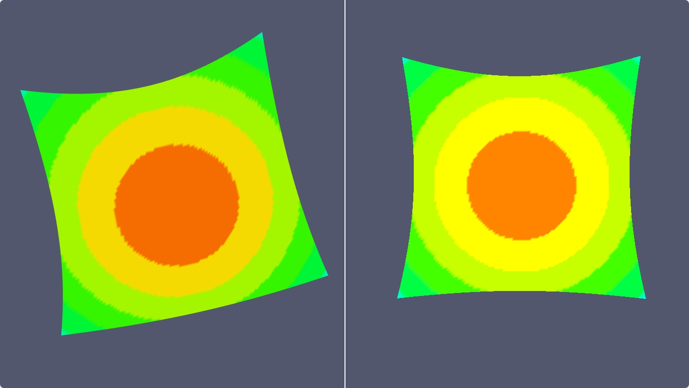

# vtk2three

A data-level conversion layer from **vtk.js** render data to **three.js** objects.
It reads a `vtkActor` / `vtkVolume` through `mapper.getInputData()` and produces an
ordinary three.js `Object3D` graph — no renderer, camera, DOM or React dependency.



## What this repository contains

| Part | Location | Output | Purpose |
| --- | --- | --- | --- |
| **Library** | `src/vtk2three/` | `dist/` (ESM + CJS + `.d.ts`) | Standalone, publishable npm package `vtk2three` |
| **Demo** | the rest of `src/` | `build/` | Side-by-side vtk.js / three.js comparison page |

Two conventions drive the design:

- **Equivalence is data-level, not pixel-level.** An actor maps to a matching
  object graph (same point coordinates, same topology, same colors). Camera and
  light synchronization are intentionally out of scope.
- **The boundary is `mapper.getInputData()`.** No per-filter adapters: any vtk
  filter chain is supported as long as its output data object is readable.

`three` and `@kitware/vtk.js` are `peerDependencies`. The library bundle has
**zero runtime vtk.js imports** — vtk.js is only used through the objects callers
pass in, and numeric vtk enums are copied into `Core/constants.ts` because
vtk.js 38 is ESM-only with no `exports` map (a CJS `require()` of a subpath
would break the CommonJS entry).

> The package has not been published yet. `import ... from "vtk2three"` below
> describes the intended public API; until published, import from
> `src/vtk2three/index.ts` locally or use `npm pack` to produce a tarball.

## Project structure

```
vtk2three/
├── index.html                  # Vite entry for the demo app
├── package.json                # scripts, peerDependencies, exports (ESM/CJS/types)
├── package-lock.json
├── .nvmrc                      # 22.22.2
├── .npmrc                      # engine-strict=true
├── vite.config.ts              # demo build + Vitest config
├── vite.lib.config.ts          # library build (lib mode, publicDir: false)
├── tsconfig.json               # strict, noEmit, covers app + tests
├── tsconfig.lib.json           # emitDeclarationOnly -> dist/
├── public/                     # static assets copied verbatim to build/
│   ├── image/hellovtk2three.png
│   ├── favicon.ico, logo192.png, logo512.png
│   └── manifest.json, robots.txt
├── src/
│   ├── index.tsx               # React root
│   ├── App.tsx / App.css / App.test.tsx
│   ├── index.css, logo.svg
│   ├── global.d.ts             # vite/client type reference
│   ├── setupTests.ts           # @testing-library/jest-dom/vitest
│   ├── reportWebVitals.ts
│   ├── routes/root.tsx
│   ├── views/
│   │   ├── HelloVTK2Three.tsx  # builds the vtk pipeline, calls convertActor()
│   │   └── ErrorPage.tsx
│   ├── threeView/main.ts       # three.js renderer, Box3 camera fit, dispose()
│   ├── vtkView/main.ts         # vtk.js FullScreenRenderWindow, dispose()
│   └── vtk2three/              # ===== standalone library =====
│       ├── index.ts            # public API (all exports listed below)
│       ├── types.ts            # options, results, capability report, stats
│       ├── ActorMapper.ts      # P4/P5 routing: actor -> object graph, signature
│       ├── SceneMapper.ts      # actors + volumes, add/remove/update sync
│       ├── VolumeMapper.ts     # vtkVolume -> V23Result, volume signature
│       ├── v23Mapper.ts        # convertActor(), createV23Result(), legacy facade
│       ├── Core/
│       │   ├── constants.ts            # numeric vtk enums (no runtime import)
│       │   ├── CellArrayReader.ts      # verts/lines/polys/strips, ear clipping
│       │   ├── UnstructuredTopology.ts# grid cell -> faces / edges
│       │   ├── GeometryMapper.ts      # topology + colors + normals + uv -> geometry
│       │   ├── ScalarColorMapper.ts   # LUT / scalar selection / RGBA / sRGB
│       │   ├── MaterialMapper.ts      # vtkProperty -> three materials
│       │   ├── TextureMapper.ts       # vtkTexture -> three Texture
│       │   ├── ImageDataMapper.ts     # ImageData -> Data3DTexture / centre slice
│       │   ├── GlyphMapper.ts         # Glyph3DMapper -> InstancedMesh
│       │   ├── VolumeRayMarcher.ts    # transfer LUT + GLSL3 ray marching
│       │   └── dispose.ts             # geometry/material/texture cleanup
│       └── __tests__/
│           ├── geometry.test.ts   topology.test.ts   colors.test.ts
│           ├── material.test.ts   actor.test.ts      grid.test.ts
│           ├── imagedata.test.ts  glyph.test.ts      volume.test.ts
├── build/                      # generated demo app (npm run build)
└── dist/                       # generated library (npm run build:lib)
```

## Requirements and scripts

Node.js **>= 22.22.2** (Vite 8 / Vitest 5 / jsdom 31). Node 18 will fail: Vite 8's
Rolldown backend imports `node:util.styleText`, available only from Node 20.12+.
`.nvmrc` pins 22.22.2 and `.npmrc` sets `engine-strict=true` so `npm install`
fails early with a clear message.

```
npm install

npm run typecheck     # tsc --noEmit
npm test              # vitest run (jsdom)
npm run build         # demo app -> build/ (also runs tsc --noEmit first)
npm run build:lib     # library  -> dist/ (ESM + CJS + .d.ts)
npm run dev           # demo dev server on :3000
npm run preview       # serve the production demo build
```

`prepack` runs `build:lib` automatically before `npm publish`. Prefer the ESM
entry — three's CommonJS entry is deprecated upstream.

### vtk.js under Vite

`optimizeDeps.exclude` contains `@kitware/vtk.js`. Pre-bundling its many
subpaths separately would duplicate the internal macro / class-override
registry, so `Rendering/Profiles/Geometry.js` would register its overrides in a
different module instance than the render window. Excluding it lets the browser
load the original ESM files and share a single registry. Because Vite's scanner
does not descend into excluded packages, `optimizeDeps.include` explicitly
prebundles vtk.js's own third-party deps (`gl-matrix`, `d3-scale`,
`fast-deep-equal`, `seedrandom`, `spark-md5`); some of them are CommonJS.

CRA's `eslint-webpack-plugin` was removed together with the webpack toolchain.
Environment variables use `import.meta.env.VITE_*` instead of
`process.env.REACT_APP_*`.

## Usage

### 1. One actor

```ts
import { convertActor } from "vtk2three";

const result = convertActor(vtkActor);
if (result) {
  threeScene.add(result.object);              // a Group named "vtkActor"
  console.log(result.report.warnings);        // partial mappings
  console.log(result.report.unsupported);     // features with no counterpart
  console.log(result.report.stats);           // points / cells / triangles / ...

  // After the vtk pipeline, mapper, property or LUT changes:
  result.update();      // rebuilds in place only when vtk mtimes changed
  result.update(true);  // force a rebuild

  // Before dropping the object:
  result.dispose();     // releases owned geometry / materials / textures
}
```

`result.object` identity is preserved across `update()`, so it can stay in the
scene. For SURFACE representation the children are `Mesh` (polys / strips),
`LineSegments` (lines), `Points` (verts) and an optional `Mesh` named
`vtkEdges`. POINTS representation emits a single `Points`; WIREFRAME uses
wireframe materials. Actor matrix and visibility are applied to the root.

### 2. A whole renderer (actors **and** volumes)

```ts
import { convertRenderer } from "vtk2three";

const sceneResult = convertRenderer(vtkRenderer, { volumeSteps: 256 });
threeScene.add(sceneResult.object);           // a Group named "vtkScene"

// Call after pipeline changes, or once per frame; it is mtime-gated.
sceneResult.sync();                           // add / remove / update
sceneResult.dispose();
```

`convertRenderer()` reads both `renderer.getActors()` and
`renderer.getVolumes()`. `sync()` returns `true` when anything changed and
refreshes the aggregated `report`.

### 3. Explicit props and a single volume

```ts
import { convertActors, convertProps, convertVolume } from "vtk2three";

const actorsOnly = convertActors([actorA, actorB]);
const mixed = convertProps({ actors: [actorA], volumes: [volumeA] });

const volumeResult = convertVolume(volumeA, {
  volumeSteps: 256,
  maxVolumeSize: 128,
});
threeScene.add(volumeResult!.object);         // Group "vtkVolumeRoot"
```

Volume rendering needs a **WebGL2** context (`Data3DTexture` + `sampler3D`).

### 4. Generic grids (no `vtkUnstructuredGrid` in vtk.js 38)

vtk.js 38 does not ship a `vtkUnstructuredGrid` class. Grid inputs are accepted
as duck-typed objects (or `HttpDataSetReader`-style serialized shapes) with
flattened VTK cell arrays:

```ts
import {
  readGeometrySource, buildGeometrySet, resolveOptions,
  gridFromDataSet, readGridTopology,
} from "vtk2three";

const raw = {
  points: new Float32Array([0,0,0, 1,0,0, 0,1,0, 0,0,1]),
  cells:  new Uint32Array([4, 0, 1, 2, 3]),   // [n, id0..idN-1, n, ...]
  cellTypes: new Uint8Array([10]),            // 10 = VTK_TETRA
};

const options = resolveOptions();
const source = readGeometrySource(raw, null, 2 /* SURFACE */, options);
const geometries = source && buildGeometrySet(source, options, 2 /* SURFACE */);
// geometries.surface / .lines / .points are ordinary BufferGeometry objects.

// Lower-level access, when you need the normalized shape or raw topology:
const grid = gridFromDataSet(raw);             // GridDataSet | undefined
const topology = grid && readGridTopology(grid, new Float32Array(grid.points), 2, options);
```

Pass representation as a numeric literal: `0` (POINTS), `1` (WIREFRAME),
`2` (SURFACE). In normal use you do not need any of this: `convertActor()`
detects a grid-shaped mapper input and routes it through the same geometry
pipeline automatically.

### 5. Options (`V23Options`)

| Option | Default | Effect |
| --- | --- | --- |
| `scale` | `1` | Point-coordinate multiplier. `1` keeps exact vtk coordinates (data-level equivalence). |
| `scalarAlpha` | `1` | Alpha passed to the lookup table while mapping scalars. |
| `computeNormals` | `true` | `computeVertexNormals()` when the data set has no normals. |
| `vertexAlpha` | `true` | Emit 4-component vertex colors when the LUT supplies alpha. |
| `mapTextures` | `true` | Convert `vtkTexture` objects attached to `vtkProperty`. |
| `triangulateConcavePolygons` | `true` | Ear-clip concave n-gons instead of a triangle fan. |
| `volumeSteps` | `256` | Ray-marching samples; clamped to `8..2048`. |
| `maxVolumeSize` | `256` | Longest-axis voxel limit; larger volumes are stride-downsampled. |
| `imageDataSlice` | `true` | Emit a textured centre slice for ImageData actor inputs. |

`resolveOptions(options)` returns the fully resolved, clamped values.

### 6. Reports and lifecycle

`CapabilityReport` has `warnings` (partial mappings), `unsupported` (no
counterpart) and `stats`. `ConversionStats` fields: `points`, `cells`,
`triangles`, `lineSegments`, `vertices`, `primitives`, `textures`, `voxels`,
`glyphs`, `volumes`.

| Result | Methods |
| --- | --- |
| `V23Result` (`convertActor`, `convertVolume`) | `object`, `report`, `update(force?)`, `dispose()` |
| `V23SceneResult` (`convertActors`, `convertProps`, `convertRenderer`) | `object`, `report`, `sync()`, `dispose()` |

The built-in `dispose()` path releases geometry, materials and only those
textures marked `userData.v23Owned = true`, so externally shared textures are
never touched. It also scans `ShaderMaterial.uniforms` for the volume's 3D
texture and transfer LUT.

### 7. Public API

| Group | Exports |
| --- | --- |
| Scene / actor / volume | `convertActor`, `convertActors`, `convertProps`, `convertRenderer`, `convertVolume`, `createV23Result`, `buildVolumeObject`, `volumeSignature` |
| Legacy | `v23Mapper` (one-actor → one-`Mesh` facade, SURFACE only) |
| Geometry | `GeometryMapper`, `buildGeometrySet`, `readGeometrySource`, `readTopology`, `triangulatePolygon`, `gridFromDataSet`, `readGridTopology` |
| Coloring / materials | `resolveScalarColors`, `MaterialMapper` |
| ImageData / glyph / volume internals | `readImageVolume`, `readImageSlice`, `buildGlyphObject`, `buildTransferFunction`, `buildVolumeMesh` |
| Options | `resolveOptions` |
| Enums (numeric copies) | `CellType`, `ScaleMode`, `OrientationMode`, `BlendMode`, `VolumeInterpolation` |
| Types | `V23Options`, `ResolvedV23Options`, `V23Result`, `V23SceneResult`, `CapabilityReport`, `ConversionStats`, `GeometrySet`, `GeometrySource`, `PointDataLike`, `MaterialSet`, `MaterialContext`, `PrimitiveBuffer`, `Topology`, `ScalarColors`, `GridDataSet`, `ImageDataLike`, `ImageVolume`, `ImageSlice`, `Glyph3DMapperLike`, `GlyphBuild`, `VolumePropertyLike`, `VolumeMaterialSet`, `VolumeBuildOptions`, `ActorBuild` |

## Data mapping reference

### vtk object → three object graph

| vtk side | Detected by | three side | Notes |
| --- | --- | --- | --- |
| `vtkActor` | `convertActor()` | `Group` `"vtkActor"` | Root identity stable; `position` / `quaternion` / `scale` / `visible` from the actor |
| `vtkRenderer` | `convertRenderer()` | `Group` `"vtkScene"` | One child group per actor / volume |
| `vtkPolyData` (`verts`/`lines`/`polys`/`strips`) | `getVerts()` present | `Mesh` + `LineSegments` + `Points`, optional `Mesh` `"vtkEdges"` | Combined according to `representation` |
| Generic grid (`points`/`cells`/`cellTypes`) | `gridFromDataSet()` | Same as PolyData | Reuses `Topology → BufferGeometry` |
| `vtkImageData` as an **actor** input | `getDimensions()` present, no `getVerts()` | `Mesh` `"vtkImageSlice"` (`MeshBasicMaterial` + `DataTexture`) + `LineSegments` `"vtkImageOutline"` | Fallback representation; `imageDataSlice: false` keeps only the outline |
| `vtkImageData` as a **volume** input | `vtkVolumeMapper.getInputData()` | `Data3DTexture` (`RedFormat`, `UnsignedByteType`) | Normalized scalars, stride downsampling, `getIndexToWorld()` placement |
| `vtkGlyph3DMapper` | `getMatrixArray()` / `isA("vtkGlyph3DMapper")` | `InstancedMesh` `"vtkGlyphs"` | `instanceMatrix` / `instanceColor` |
| `vtkVolume` + `vtkVolumeMapper` | `convertVolume()` | `Group` `"vtkVolumeRoot"` → `Mesh` `"vtkVolume"` with `ShaderMaterial` (GLSL3) | Ray marching + 256×1 RGBA transfer LUT |
| `vtkProp3D.getMatrix()` | any actor / volume | Root `position` / `quaternion` / `scale` | vtk matrix is transposed (row-vector); three needs one `.transpose()` before `decompose()` |

### Geometry and attribute mapping

| vtk data | three.js resource |
| --- | --- |
| `points` (`Float32Array`) | `BufferGeometry.position` (identical values when `scale = 1`) |
| Cell connectivity (`verts`/`lines`/`polys`/`strips`, flattened CellArray) | `BufferGeometry.index` (`Uint16Array` / `Uint32Array`) |
| Cell-associated scalars | **non-indexed** geometry with colors expanded per vertex |
| `pointData.getNormals()` | `normal` attribute; otherwise `computeVertexNormals()` |
| `pointData.getTCoords()` | `uv` attribute |
| `vtkLookupTable.mapScalars()` | `color` attribute (3 or 4 components, sRGB → linear) |
| `vtkTexture` (6 slots) | `map`, `normalMap`, `aoMap`, `emissiveMap`, `metalnessMap`, `roughnessMap` |
| `vtkColorTransferFunction` + `vtkPiecewiseFunction` | `DataTexture` 256×1 RGBA LUT |
| `vtkGlyph3DMapper.getMatrixArray()` | `InstancedMesh.instanceMatrix` (16 floats per glyph) |
| `vtkGlyph3DMapper.getColorArray()` | `InstancedMesh.instanceColor` (sRGB → linear) |
| `getIndexToWorld()` + original dimensions | Volume `Mesh.matrix` (unit cube placed in index space) |

### `vtkProperty` → three material

| vtk state | three.js material / object |
| --- | --- |
| `lighting = false` | `MeshBasicMaterial` |
| `interpolation = FLAT` / `GOURAUD` (default branch) | `MeshLambertMaterial` (`flatShading` for FLAT) |
| `interpolation = PHONG` | `MeshPhongMaterial` (specular color / power) |
| `interpolation = PBR` | `MeshPhysicalMaterial` (metallic, roughness, ior, clearcoat, transmission, thickness, attenuation, iridescence, specular, anisotropy, sheen) |
| Line primitives | `LineBasicMaterial` (`linewidth`; WebGL ignores values > 1) |
| Point primitives | `PointsMaterial` (`size`, no size attenuation) |
| `edgeVisibility` + SURFACE | Extra `Mesh` `"vtkEdges"` with a wireframe `MeshBasicMaterial` |
| `representation` | POINTS → `Points` only; WIREFRAME → wireframe materials; SURFACE → full primitive set |
| `backfaceCulling` / `frontfaceCulling` | `FrontSide` / `BackSide`, otherwise `DoubleSide` |
| `opacity`, vertex alpha | `transparent` + `opacity` |

### Supported VTK cell types (`CellType`)

| Value | Cell | Mapping |
| --- | --- | --- |
| 1, 2 | `VTK_VERTEX`, `VTK_POLY_VERTEX` | points primitive |
| 3, 4 | `VTK_LINE`, `VTK_POLY_LINE` | line segments |
| 5 | `VTK_TRIANGLE` | surface triangle |
| 6 | `VTK_TRIANGLE_STRIP` | alternating-winding strip expansion |
| 7 | `VTK_POLYGON` | ear clipping (triangle-fan fallback) |
| 8 | `VTK_PIXEL` | quad with vtk's interleaved axis order |
| 9 | `VTK_QUAD` | surface quad |
| 10–16 | `VTK_TETRA`, `VTK_VOXEL`, `VTK_HEXAHEDRON`, `VTK_WEDGE`, `VTK_PYRAMID`, `VTK_PENTAGONAL_PRISM`, `VTK_HEXAGONAL_PRISM` | outward-facing surface triangulation + wireframe edges |
| 0 | `VTK_EMPTY_CELL` | ignored |
| `> 16` | quadratic / higher-order / polyhedron | reported as `warnings` and skipped |

### Other exported enums

`ScaleMode` (`SCALE_BY_CONSTANT` / `MAGNITUDE` / `COMPONENTS`),
`OrientationMode` (`DIRECTION` / `ROTATION` / `MATRIX`),
`BlendMode` (`COMPOSITE_BLEND`, `MAXIMUM_INTENSITY_BLEND`,
`MINIMUM_INTENSITY_BLEND`, `AVERAGE_INTENSITY_BLEND`,
`ADDITIVE_INTENSITY_BLEND`, `RADON_TRANSFORM_BLEND`,
`LABELMAP_EDGE_PROJECTION_BLEND`) and
`VolumeInterpolation` (`NEAREST` / `LINEAR` / `FAST_LINEAR`).
Only the first five `BlendMode` values are rendered; Radon and label-map edge
projection fall back to COMPOSITE with a warning.

## Coverage (P1–P5) and known degradations

| Area | Mapped | Known degradations |
| --- | --- | --- |
| P1 topology | verts / lines / polys / strips, arbitrary n-gons (ear clipping), wireframe / point representation, Uint16/32 indices, point-cloud fallback | non-simple polygons fall back to a triangle fan with a warning |
| P2 scalars | scalarVisibility, ColorMode, ScalarMode, colorByArrayName, point / cell / field-data colors, LUT range + alpha, RGBA vertex colors, uv from TCoords | `interpolateScalarsBeforeMapping` bakes per-point colors; BY_ID has no public arrayId getter in vtk.js 38 |
| P3 material | Lambert / Phong / Physical (PBR), flat shading, culling, opacity, representation, point size, edge overlay, six texture slots | lineWidth > 1 ignored by WebGL; packed ORM/RM textures and alphaMode/alphaCutoff unsupported; texture Y flip may differ |
| P4 actor/scene | actor matrix + visibility, multi-actor groups, mtime-based `update()` / `sync()`, full dispose, aggregated report + stats | camera / lights not synced; vtkActor2D / text / annotation props unsupported |
| P5 ImageData | `Data3DTexture` upload (origin / spacing / direction via `getIndexToWorld`), stride downsampling, textured centre slice + bounding box for actor inputs | only scalar component 0; an ImageData used by a plain `vtkMapper` is a fallback slice, not a full `vtkImageSlice` renderer |
| P5 grid | linear VTK cells with outward face triangulation and wireframe edges | **vtk.js 38 ships no `vtkUnstructuredGrid` class** — grids come in as duck-typed objects or serialized `points`/`cells`/`cellTypes`; quadratic / higher-order / polyhedron cells are reported and skipped |
| P5 glyph | `vtkGlyph3DMapper.buildArrays()` matrices + LUT colors → `instanceMatrix` / `instanceColor`; fallback recomputes DIRECTION / ROTATION / MATRIX orientation and CONSTANT / MAGNITUDE / COMPONENTS scaling | glyph normal array not used (three derives normals from the instance matrix); no glyph masking / decimation |
| P5 volume | `vtkVolume` + `vtkVolumeMapper` → GLSL3 ray marching with COMPOSITE / MIP / MinIP / AVERAGE / ADDITIVE, transfer functions baked into a 256×1 LUT, `scalarOpacityUnitDistance` correction, mtime-driven `update()`, full texture dispose | single directional gradient light instead of full volume shading; no gradient opacity, no Radon / label-map edge projection (fall back to COMPOSITE with a warning); requires WebGL2 |

## WebGL2 and verification

Volume rendering compiles a GLSL3 shader that samples a `sampler3D`. The shader
computes the world→local camera transform in the **vertex** stage (`vRayOrigin`)
because three.js injects `modelMatrix` only into vertex shader prefixes.
With `glslVersion: GLSL3`, three does not inject `pc_fragColor`, so the fragment
shader declares its own `layout(location = 0) out vec4 fragColor`.

Current verification status:

- `npm run typecheck && npm test && npm run build && npm run build:lib` — all
  green; **10 test files / 64 tests passed**.
- `dist/vtk2three.cjs` contains only `require("three")`; no vtk.js runtime
  imports in either bundle.
- The volume shader was compiled, linked and rendered in a real WebGL2 context
  (headless Chrome + SwiftShader): raw GLSL compile/link, a real three r187
  `WebGLRenderer` draw, and a draw of `buildVolumeMesh()` loaded from the built
  `dist/vtk2three.js`. All three reported `glError: 0x0`, no shader
  diagnostics and non-zero center pixels.
- Manual side-by-side visual comparison in a browser is still outstanding; it
  is not part of the data-level acceptance criterion.

> Troubleshooting: if every Vitest suite fails at once with
> `Vitest failed to find the current suite` or
> `Cannot read properties of undefined (reading 'config')`, remove
> `node_modules/.vite` (stale `deps_temp_*` directories from an interrupted
> dependency pre-bundle) and let Vite rebuild the cache. It is not a source or
> Node-version problem.

## Running the demo

```
npm run dev        # or npm run start
```

Open <http://localhost:3000/hellovtk2three>. The page builds a vtk pipeline
(`PlaneSource → Calculator → WarpScalar → vtkMapper/Actor`), renders it with
vtk.js on the left and converts the same actor with `convertActor()` for the
three.js view on the right. Both views release their WebGL contexts on unmount.

## Current dependencies

- `@kitware/vtk.js` 38.x — ESM-only package with no `exports` map; subpath imports use explicit `.js` extensions.
- `three` 0.187.x (r187) — addons via `three/addons/*`, physically correct lights (r155+), vertex colors in linear-sRGB working space (r152+).
- Vite 8 + `@vitejs/plugin-react` 6 (Rolldown-based), Vitest 5 with jsdom.
- TypeScript 5.6 (`strict`, `moduleResolution: bundler`, `noEmit`) with `@types/three` 0.187, `@types/react(-dom)` 18, `@types/node` 22.
- Internal relative imports have no extension; node_modules imports keep `.js`.

## Before the first publish

Confirm the package name / scope, add a `license` field, and add a CHANGELOG and
CI running the verification chain above.
